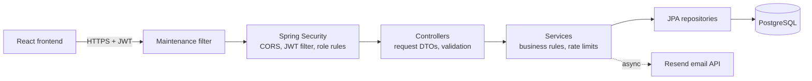

# UserManager — Backend

REST API for UserManager, a full-stack account and social-feed application. It handles
registration with email verification, login, password reset, profile and email changes,
account lifecycle, and a feed of posts, comments and likes, with role-based access for
administrators.

**Live demo:** [usermanager-frontend.vercel.app](https://usermanager-frontend.vercel.app)
(use **Fill demo login** on the sign-in page) · **Frontend repository:**
[tizreal/usermanager-frontend](https://github.com/tizreal/usermanager-frontend)

The demo is pre-loaded with fictional sample data: posts by the Ada, Alan and Grace accounts
are sample content, and posts made with the demo account are cleared automatically.

The API runs on Render's free tier and sleeps when idle, so the first request can take a
minute or two.

## Tech stack

| Area | Technology |
|---|---|
| Language and framework | Java 21, Spring Boot 3.4, Spring Web, Spring Data JPA |
| Security | Spring Security, JWT (Auth0 java-jwt), BCrypt |
| Database | PostgreSQL, Flyway migrations, Hibernate in `validate` mode |
| Email | Resend HTTP API with Thymeleaf templates, sent asynchronously |
| Testing | JUnit 5, Spring MockMvc, Testcontainers (PostgreSQL 16) |
| Delivery | Docker (multi-stage build), GitHub Actions, Render, Neon PostgreSQL |

## Architecture



Controllers accept and return DTOs only, so entity fields such as password hashes or roles
can't be read from responses or set from request bodies. Services own the business rules;
the database enforces what must hold even under concurrency (unique case-insensitive
usernames and emails, single-use reset tokens).

## Security design

**Authentication**
- Passwords are hashed with BCrypt; login returns a signed JWT in the `Authorization` header.
- Tokens carry a purpose claim, so an email-verification token can't be used as an access
  token, and a token version: changing or resetting a password increments the account's
  version and signs out every existing session.
- Each request re-checks the account behind the token (exists, active, verified, current
  token version), so a deactivated account loses access immediately.

**Authorization**
- Roles `USER` and `ADMIN`, enforced on the server by URL rules and `@PreAuthorize`.
- Users can delete only their own posts; admins can delete any post.
- Listing users, deactivating, reactivating and deleting other accounts are admin-only.
- Signup ignores fields such as `role` or `userId`, so privileges can't be self-assigned.

**Account recovery and email changes**
- Password-reset links contain a 256-bit random token; only its SHA-256 hash is stored. It
  expires after 10 minutes and is consumed with a single conditional `UPDATE`, so it works
  exactly once even under concurrent requests.
- The reset endpoint answers the same way whether or not an address is registered.
- Changing the password or email requires the current password. A new email address takes
  effect only after it is confirmed from that inbox.

**Abuse protection and operations**
- Rate limits per account and per user (for example 10 login attempts per 15 minutes per
  username, 3 reset emails per hour per address, limits on posts, comments and likes).
- Client IPs are taken only from a configured, trusted proxy header; `X-Forwarded-For` is
  never trusted.
- Tokens, passwords and reset links are never logged (covered by tests).
- A maintenance mode returns `503` for every endpoint except `/api/health` unless a
  request carries a server-side bypass key, used to verify releases before opening them.

**Account lifecycle**
- Admins can deactivate (reversible) or delete accounts. Deletion anonymizes personal data;
  the account's posts and comments remain in threads as "Deleted user" with their text
  replaced by `[deleted]`.
- The public demo account can't change its profile or credentials, request a reset or
  delete itself.

## API overview

All paths are under `/api`.

| Area | Endpoints | Access |
|---|---|---|
| Health | `GET /health` | Public |
| Accounts | `POST /user/signup`, `GET /user/verify/email`, `POST /user/login`, `GET /user/reset/{email}`, `POST /user/reset` | Public |
| Own account | `GET /user/get`, `POST /user/update`, `POST /user/delete-account` | Signed in |
| Feed | `GET /posts/`, `POST /posts/create`, `POST /posts/{id}/like`, `POST /posts/{id}/unlike`, `DELETE /posts/{id}`, `GET /comments/{postId}`, `POST /comments/create` | Signed in (delete: owner or admin) |
| Administration | `GET /user/`, `GET /user/{username}`, `DELETE /user/{userId}`, `POST /user/{userId}/deactivate`, `POST /user/{userId}/reactivate`, `POST /admin/demo-content/cleanup` | Admin |

## Database

The schema is versioned with Flyway (`UserManager/src/main/resources/db/migration`):
`users`, `posts`, `comments` and `password_reset_tokens`. Hibernate only validates the
schema at startup and never changes it. Migration tests cover a fresh database, upgrading a
populated one, and resuming after a failed migration.

## Testing and CI

```bash
cd UserManager
./mvnw verify      # requires Docker for Testcontainers
```

152 tests: 20 unit tests and 132 integration tests that run against a real PostgreSQL 16
container. They cover authentication, authorization for every role, account takeover and
mass-assignment attempts, password reset and token reuse, email changes, account lifecycle,
demo restrictions, rate limits, client-IP resolution, maintenance mode, log redaction and
the migrations. GitHub Actions runs `./mvnw -B verify` on every push and pull request.

## Running locally

Requirements: Java 21, Docker.

1. Start PostgreSQL:
   ```bash
   docker run -d --name usermanager-db -e POSTGRES_PASSWORD=postgres -p 5432:5432 postgres:16-alpine
   ```
2. Set the environment variables (Flyway creates the schema on first start):
   ```bash
   export DATABASE_URL=jdbc:postgresql://localhost:5432/postgres
   export DATABASE_USERNAME=postgres
   export DATABASE_PASSWORD=postgres
   export JWT_SECRET="$(openssl rand -base64 64)"   # at least 32 bytes
   export RESEND_API_KEY=re_xxx                      # a real key is needed only to send email
   export MAIL_HOST=localhost MAIL_USERNAME=unused MAIL_PASSWORD=unused
   export CLIENT_URL=http://localhost:5173           # frontend URL used in email links
   export CLIENT_IP_MODE=REMOTE_ADDR                 # no proxy in front locally
   export APP_SEED_DEMO=true                         # optional: demo account and sample feed
   ```
3. Run the API on `http://localhost:8080/api`:
   ```bash
   cd UserManager
   ./mvnw spring-boot:run
   ```

## Project structure

```
UserManager/src/main/java/com/tca/UserManager/
├── config/       security configuration, demo data seeding
├── controller/   REST endpoints
├── domain/       error response body
├── dto/          request and response types
├── entity/       JPA entities
├── exception/    error responses
├── filter/       JWT and maintenance filters
├── provider/     configuration values (URLs, expirations)
├── repository/   Spring Data repositories
├── security/     JWT service, rate limiter, client-IP resolution
└── service/      business logic
```
